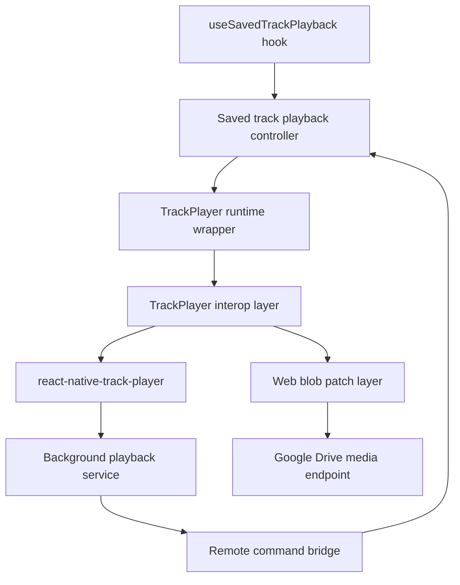

# Mobile Cross-Platform Audio Playback

This document explains how the mobile rehearsal player implements cross-platform playback with `react-native-track-player` and web runtime support that depends on `shaka-player`.

## Summary

- Native iOS and Android playback uses `react-native-track-player` directly.
- Web playback also uses `react-native-track-player` (web runtime), but media loading is patched so authenticated Google Drive requests can be fetched with headers and replayed as blob URLs.
- Background and lock-screen transport controls are bridged through a module-level command handler so native remote events can drive the active React playback controller.

## Why `shaka-player` Is in This App

- `shaka-player` is included as a direct dependency of `@org/mobile-rehearsal-player` to satisfy the web runtime path used by `react-native-track-player`.
- Without this dependency, Expo web/export can fail during module resolution before render.
- The app code does not import `shaka-player` directly; it is required by the TrackPlayer web stack.

## Playback Architecture

## Key Modules

- App entry and service registration:
  - `packages/mobile-rehearsal-player/index.js`
- TrackPlayer interop and environment detection:
  - `packages/mobile-rehearsal-player/src/app/library/playback/utils/saved-track-player-interop.ts`
- Web runtime patching (header fetch -> blob URL -> cleanup):
  - `packages/mobile-rehearsal-player/src/app/library/playback/utils/saved-track-player-web-load.ts`
- Web media download (streamed progress, slow flag, abort on reset) and its progress store:
  - `packages/mobile-rehearsal-player/src/app/library/playback/utils/saved-track-web-download.ts`
  - `packages/mobile-rehearsal-player/src/app/library/playback/utils/saved-track-download-progress.ts`
- Playback shaping engine, pitch capability, and the web pitch graph:
  - `packages/mobile-rehearsal-player/src/app/library/playback/shaping/`
- Recording overlay (web only; see [Recording Overlay](#recording-overlay-web)):
  - `packages/mobile-rehearsal-player/src/app/library/recording/overlay/`
  - `packages/audio-mixing/src/lib/sync-controller.ts`
- Player setup and capability sync:
  - `packages/mobile-rehearsal-player/src/app/library/playback/utils/saved-track-player-runtime.ts`
- Playback request construction (Drive URL + auth headers):
  - `packages/mobile-rehearsal-player/src/app/library/playback/utils/saved-track-playback-view-model.ts`
- Runtime load/play/pause/seek commands:
  - `packages/mobile-rehearsal-player/src/app/library/playback/utils/saved-track-playback-controller/runtime-core.ts`
  - `packages/mobile-rehearsal-player/src/app/library/playback/utils/saved-track-playback-controller/runtime-commands.ts`
- Remote command bridge:
  - `packages/mobile-rehearsal-player/src/app/library/playback/utils/saved-track-playback-remote-controls.ts`
  - `packages/mobile-rehearsal-player/src/app/library/playback/utils/saved-track-playback-service.ts`
- Hook that binds playback state/effects and remote handlers:
  - `packages/mobile-rehearsal-player/src/app/library/playback/hooks/use-saved-track-playback/effects.ts`

## Platform Behavior

### Native iOS and Android

- `resolveSavedTrackPlayerSupport` loads TrackPlayer unless runtime detection identifies Expo Go.
- `ensureSavedTrackPlayerReady` calls `setupPlayer` once and applies base transport capabilities.
- `syncSavedTrackPlayerCapabilities` enables queue next/previous controls when a playlist session is active.
- `registerSavedTrackPlayerPlaybackService` wires TrackPlayer remote events to the app service.

### Web

- Interop applies the web patch only when `Platform.OS === 'web'` and browser APIs are present.
- Tracks with auth headers are fetched manually, converted to blob URLs, and passed into TrackPlayer runtime calls.
- Blob URLs are tracked and revoked on `reset` and `stop` to avoid leaks.
- `reset` and `stop` also abort any download still in flight, so a superseded load rejects with an abort error (which the controller ignores) instead of adding a stale track.
- A player-level load patch updates the media element source for blob playback (`window.rntp`).

### Expo Go Guardrail

- Playback is intentionally disabled in Expo Go because native TrackPlayer is unavailable there.
- Interop returns a stable unsupported state and message so UI can degrade gracefully.

## Remote Control Flow

1. App startup registers `savedTrackPlaybackService` via `registerPlaybackService`.
2. The service subscribes to TrackPlayer remote events (`RemotePlay`, `RemotePause`, `RemoteNext`, `RemotePrevious`).
3. Those events dispatch module-level remote commands.
4. `useSavedTrackPlayback` registers handlers that call the active controller methods.

This separation keeps background service code lightweight while allowing current in-memory app state and queue logic to stay inside the React/controller layer.

## Authenticated Drive Playback Flow

1. `createSavedTrackPlaybackRequest` builds a track payload with Drive media URL and `Authorization: Bearer ...` headers.
2. Runtime commands reset TrackPlayer, add the requested track, seek to range start, and optionally play.
3. On web, header-bearing requests are fetched first and rewritten to blob URLs before TrackPlayer consumes them.

## Waveform Peaks

The waveform draws the item's own audio, never a synthetic shape (design Decision 4). Modules:

- `@org/audio-library-models` `waveform-peaks.ts`: the framework-agnostic model. One byte per bucket, one bucket per millisecond up to 120,000 (`getPeakBucketCount`), `computeWaveformPeaks` from PCM, serialization, and `resolveWaveformBars` to slice an item's range into display bars.
- `library/playback/waveform-peaks/`: `peak-registry.ts` (in-memory view per Drive file, shared analyses), `peak-cache.ts` (Drive-version keyed, size-budgeted LRU), `peak-store.web.ts` (IndexedDB) and `peak-store.ts` (AsyncStorage), `peak-extractor.web.ts` (`decodeAudioData`) and `peak-extractor.ts` (native: none yet), `peak-extraction-service.ts`, and `use-waveform-peaks.ts`.
- Flow on web: `saved-track-web-download.ts` announces each finished download (`saved-track-download-events.ts`); the service decodes those bytes once, publishes the peaks to the registry, and persists them. `PlaybackWaveform` calls `useWaveformPeaks(source)` and draws the flat placeholder band until peaks exist, so a file shows real peaks after its first play and on later visits.
- Not yet covered: native extraction, and files that have never been played (tasks 8.41, 8.43).

## Playback Shaping (Speed and Pitch)

Speed and pitch are two independent axes (design Decision 6 of `nocturne-visual-system-and-playback-shaping`). The engine lives in `library/playback/shaping/` and is reached through `getPlaybackShapingEngine()`; callers clamp to the product ranges before calling it.

| Axis                             | Web                                                              | iOS                                                                                       | Android                                      |
| -------------------------------- | ---------------------------------------------------------------- | ----------------------------------------------------------------------------------------- | -------------------------------------------- |
| Speed (always pitch-preserving)  | element `playbackRate`; browsers keep pitch via `preservesPitch` | `setRate`; tracks carry the `Music` pitch algorithm (`pitch-preserving-track-options.ts`) | `setRate` (ExoPlayer speed, pitch stays 1.0) |
| Semitone pitch (tempo unchanged) | SoundTouch AudioWorklet (`@soundtouchjs/audio-worklet`)          | **not implemented**                                                                       | **not implemented**                          |

- `playback-shaping-engine.ts`: `setSpeed(SpeedTransform)` / `setSpeedMultiplier`, `setPitchSemitones`, `getState`, `reset`. `SpeedTransform` is `multiplier | tempoMap`; only `multiplier` is implemented and `tempoMap` rejects with `UnsupportedSpeedTransformError`.
- `canShapePitch` is defined in one place (`playback-shaping-capabilities.ts`, with the reasons). Where it is false, `setPitchSemitones` returns `{ applied: false }`, changes no state, and never approximates pitch through the rate (that would change tempo). The shaping UI shows an inert pitch control with `PITCH_UNAVAILABLE_REASON` instead. Native pitch is deliberately deferred (tasks 8.51); it needs new native modules because iOS plays through `AVPlayer` (via `SwiftAudioEx`) and `react-native-track-player` exposes no pitch on Android.
- Web pitch graph (`web-pitch-shifter-core.ts`, wired in `web-pitch-shifter.web.ts`): media element → `createMediaElementSource` → a direct (dry) path and a SoundTouch (wet) path → destination, built on the first non-zero pitch. At 0 st the audio crossfades (10 ms time constant) to the dry path and the pitch node is disconnected, so speed-only playback after touching pitch runs no extra DSP. Changing the pitch value makes SoundTouch reset its buffers, which leaves a gap of about 3 ms per change; it is inherent to the processor and is not hidden. The element keeps tempo (`playbackRate` with `preservesPitch`), and its volume and mute still apply upstream, so the volume slider needs no extra gain node. Pitch changes are applied in call order.
- The processor script ships as a Metro asset, `assets/audio/soundtouch-processor.worklet` (extension registered in `metro.config.js`), because the worklet scope loads it by URL. It is fetched and re-served as a `text/javascript` blob (`addModule` rejects other MIME types). A spec keeps it identical to the installed package's file; re-copy `.dist/soundtouch-processor.js` after upgrading the package.
- Measured on web (2026-10-02, preview at 375 × 812, audio routed to an analyser): +3 st read 525 Hz (target 523.3), −5 st 329.1 Hz (329.6), 0 st 441 Hz (440), and +3 st at 0.7× speed still 525 Hz; graph build 55 ms; SoundTouch costs about 0.1% of a core on a 5-minute track in a Node benchmark.
- Pacing and redundant writes (`playback-shaping-session.ts`, `coalesced-runner.ts`): the displayed value follows the finger at once, but the player is only sent changed values, one run at a time, at most once per 120 ms, with the newest value always last; loads rewrite both values. Every rate or pitch change makes a player re-synchronize its audio (AVPlayer rewrites `rate` on each call, ExoPlayer reconfigures its speed processor, the browser re-initializes its time-stretch), so an unpaced slider drag (about 60 changes a second) is heard as stutter and jumps in speed. A pitch tap no longer rewrites the rate and a speed change no longer rewrites the pitch.
- `reset()` on the player between items (`loadIntoPlayer` resets and re-adds the track) may drop the native rate; the session wiring (task 5.3) must re-apply the active shaping after each load.

## Recording Overlay (Web)

A recording plays together with its track without changing how the track plays (design Decision 5 of `rehearsal-recording`). The track keeps going through the player above; the recording is a second voice that follows it. Native has no overlay or recording yet (`native-playback-follow-ups`).

- **Transport:** `recording-transport.web.ts` wraps the player's media element (`globalThis.rntp.getMediaElement()`) as a `Transport` (`getPositionMs`, `isPlaying`, and `play`, `pause`, `seek` events); `createLoopAwareTransport` adds the loop wrap. `recording-transport.ts` returns `null` on native.
- **Voice and sync:** `recording-overlay.web.ts` creates one shared `AudioContext` and plays the recording's WAV through it a window at a time (`createWavWindowReader`, `createWindowedVoice`) into a gain node. `createSyncController` (in `@org/audio-mixing`) looks up the recording position for the track position in the recording's timeline, starts the voice on play, stops it on pause, and restarts it on a seek or a loop wrap; every 250 ms it reschedules the voice when it has drifted by more than about 20 ms.
- **Host:** `recording-overlay-host.tsx` follows the active playback item. A recording item starts one overlay; playing anything else, or another recording, ends it and gives the track its full volume back. It waits for the track to load so it attaches to the element that is playing.
- **Balance and latency:** `recording-mix-store.ts` holds the live balance, which `recording-overlay-host.tsx` turns into the recording's gain and the track's volume (`setTrackGain`); `recording-sync-store.ts` and `recording-sync-model.ts` hold the latency nudge, which `recording-device-latency.ts` can save per output device (`output-device-key.web.ts`); `click-calibration-*.ts` measures the real round trip.
- **Shaping:** the track is shaped (speed and pitch) as usual; the recording is never shaped. A recording item locks the shaping controls to the speed and pitch stored on the recording, so it stays aligned (`reset()` between items re-applies them like any other load).
- **Preview:** the save sheet and export dialog preview a balance through `recording-preview-host.tsx` and `recording-preview-request.ts`, using the same overlay.
- **Original audio:** an overlay or a mix needs the original track, found from the recording's own metadata (Drive file id and content version) through the normal playback cache, the offline store or Drive (`recording-original.ts`); nothing is copied per recording.
- **Mix render:** an exported mix does not use the live path. `renderMix` in `@org/audio-mixing` renders it offline in chunks from the metadata, the recording and the decoded original, with a SoundTouch stretcher so the track is at the speed and pitch it had while recording.

## Composite Tracks (Web)

A composite plays several stems (one mono track per voice) as one item with its own mix (design Decisions 1 to 14 of `composite-tracks`). It does not use the track player's media element: a Web Audio engine plays it, and the player wrapper makes the rest of the app treat it as the current player. Native has no composites yet (`native-playback-follow-ups`).

- **Item and owner:** a composite is a `PlayableItem` of kind `composite` over a synthetic audio source whose id is the composite id (`createCompositeSource` in `audio-library-models`, `isCompositeSource` by mime type). `createCompositeOwnerSources` makes it its own marker, loop and offline owner through the code that already reads `item.source`. Lyrics and sheet music are not copied: they are read from the stems (`composite-content.ts`, `composite/content/`), and an edit goes to the stem's track.
- **Prepared stems, not memory:** every stem is decoded once, mixed to mono, resampled to the audio context's rate and written to a local store as 16-bit PCM in chunks (`composite/prepared/`: `prepareStem`, `PreparedStemStore`, an IndexedDB backend). A stem is read back as a window reader (`createWavWindowReader`), so memory stays small whatever the length. The store is a cache keyed by composite, stem and the track's content version: `Clear all` in the offline files view clears it (the `Prepared composites` group), and a composite prepares again on its next play, with `Preparing stems · first time only`. Before preparing, `checkCompositeStorageFit` and a quota failure give the no-room state (`composite-room.ts`).
- **Loading:** `loadCompositeStems` (`composite/loading/`) loads every stem before play starts, so the mix never changes under the singer. A stem whose track is gone or unavailable is skipped and flagged `Stem missing`; the loader and the export share `createStemLoader` (through `buildStemLoaderDependencies`).
- **Engine:** `createCompositeEngine` (`composite/engine/`) builds the graph: one windowed voice per stem, a gain per stem, a sum, an optional SoundTouch pitch stage when the sum is shaped, the mix limiter (`createOverlayLimiter`, the same ceiling the export ends in), a master gain and the output. It owns play, pause, seek, loop wrap and the stem gains; the browser factory is `create-web-composite-engine.web.ts`. Speed and pitch are applied to the sum, not per stem, so stems cannot drift apart.
- **Player wrapper:** `composite/playback/` keeps an active-engine registry (`setActiveCompositeEngine`). `getSavedTrackPlayer()` returns `createCompositeAwarePlayer(...)`, a proxy that sends play, pause, seek, rate, volume, position and duration to the engine while one is active and to the real player otherwise, so the controller, the remote controls, the progress hooks and the loop-aware transport need no composite branch. Pitch goes through `wrapPitchShifterForComposite`. `loadIntoPlayer` has one composite branch (`load-composite-item.ts`) that resets the player first, so the previous track releases its media element and blob URLs.
- **Mix:** the session mix (`composite/mix/session-mix-store.ts`, `reduceSessionMix` and `resolveStemGains` in `@org/audio-mixing`) starts from the composite's default mix and starts over when another composite plays; the Mix panel changes it and feeds the engine's gains. Presets, mute and solo are pure functions in `composite-mix.ts`. The composite waveform is combined from the prepared stems' peaks with the gains (`composite/waveform/`).
- **Export:** `Export…` in the Mix panel renders the current mix and shaping offline with `renderComposite` in `@org/audio-mixing` (stems read through window readers, placed by offset, gained, summed in blocks, shaped as a sum by `createSoundTouchSumShaper`, then the same `createMixLimiter` as a recording's export) to a mono 16-bit WAV. `runCompositeExport` (`composite/export/`) prepares missing stems first, then delivers through `deliverExportFile`, shared with the recording export (a download or a resumable Drive upload). The export reads the mix with `peekSessionMix` and changes no live state.

## Slow Connections (Web)

Web playback cannot stream an authenticated Drive file: the media element cannot send the `Authorization` header, so the web patch downloads the **whole file** (`GET …/files/<id>?alt=media`) into a blob before TrackPlayer gets it. Playback therefore starts only when the download finishes, and that takes as long as the connection needs. Measured on 2026-09-30 on a connection the browser reported as `3g` (1.3 Mbps, 350 ms RTT): a 3:08 MP3 took **92.7 s** to download. Native streams directly and has no download step.

What the app shows (task 8.33 of `nocturne-visual-system-and-playback-shaping`):

- The tapped item becomes the active item, and a started playlist or queue becomes the active session, **before** the download begins. The mini-player, the sheet, the loading row's `Loading…` control, and the queue controls (Up Next, previous / next, repeat, shuffle, `Play next` / `Add to queue`) appear at once.
- The mini-player context line and the sheet read `Loading from Google Drive · 42%` (from `Content-Length`; no percentage when the response has none), then after 5 s `Slow connection · 42% downloaded`. The play / pause ring shows a spinner.
- Starting another item, playlist, or queue position during the download supersedes it: the player resets, the old download is aborted, and nothing is reported as an error. Only the loading item's own control stays disabled.
- In development builds, a download that passes 5 s logs one `console.warn` starting `[playback] Slow web media download:` with the Drive file id, elapsed time, and bytes received so far.

How to tell a slow connection from a playback bug in the browser:

- `navigator.connection` gives the browser's estimate (`effectiveType`, `downlink` in Mbps, `rtt` in ms).
- A Resource Timing entry for the `alt=media` request appears only once the response ends; its `duration` is the download time. While it is still running there is no entry at all, which is easy to misread as "no request was made".
- To exercise the loading state on a fast connection, slow every stream read in the page before pressing play, for example by wrapping `ReadableStreamDefaultReader.prototype.read` with a 300 ms delay in the devtools console.
- Browser-pane screenshots can lag the DOM; read the mini-player's `Now playing: …` accessibility label or the page text to see the current state.

## Implementation Notes

- Playlist entry identity uses a TrackPlayer id strategy that includes `playlistEntryId` when present, so duplicate source tracks in a queue remain distinct.
- Duration probing includes a temporary muted play fallback for Drive tracks that delay metadata duration.
- The web patch is idempotent and symbol-guarded to avoid re-patching runtime/player methods.

## Testing and Verification

- Unit tests for interop/runtime patching and service behavior live alongside playback utilities under:
  - `packages/mobile-rehearsal-player/src/app/library/playback/utils/*.spec.ts`
- Typical validation targets:
  - `npm exec -- nx run mobile-rehearsal-player:test`
  - `npm exec -- nx run mobile-rehearsal-player:typecheck`
  - `npm exec -- nx run mobile-rehearsal-player:build` (web export path)

## Debugging the Web Player

- Silence the preview with `media.volume = 0`. Setting `media.muted = true` makes Chrome pause the element as background media, which shows up as `Paused` while the position keeps advancing. The media element is not in the DOM, so patch `HTMLMediaElement.prototype.play` to set the volume.
- To trace a start, wrap `HTMLMediaElement.play` / `pause` / `load`, `URL.createObjectURL` / `revokeObjectURL`, `Storage.prototype.setItem` and `console.error`, and log a timeline relative to the click. A plain start makes one `play()` call; the web TrackPlayer's `add` ends in `goToIndex` → `play`, so a start while the player was already running also shows the app's explicit `play()` as a second, no-op call.
- Expect a few `net::ERR_FILE_NOT_FOUND` blob requests next to `206` ones around a track change (the previous source's last range request); the Drive `400` errors seen while browsing are metadata calls that ask for `durationMillis`, not playback.
- Recording in the preview pane: the pane blocks the microphone, so inject a fake one before the page asks (an `AudioContext` oscillator into `createMediaStreamDestination`, returned from a patched `navigator.mediaDevices.getUserMedia`). The pane also reports the page hidden about every two seconds, which stops a take as in the background (`hidden`, shown as `too short` under a second), and throttles timers to one second; override `document.visibilityState` and stop `visibilitychange` in capture to test a take, and expect starts and stops to be up to a second late there.
- The `mobile-web-runtime-debugging` skill has the full recipe and the scripted-pointer notes.

## When To Update This Doc

Update this document whenever any of the following changes:

- playback runtime selection or platform guards
- TrackPlayer initialization/options/capability behavior
- web blob patch mechanics or cleanup behavior
- background remote-event command bridge shape
- dependency strategy for TrackPlayer web runtime, including `shaka-player`
- the recording overlay path (the transport, the voice, the sync controller, or how the track's volume and shaping are shared with it)
- the composite path (the engine graph, the player wrapper, prepared stems and their store, the stem loader, or the mix export)
